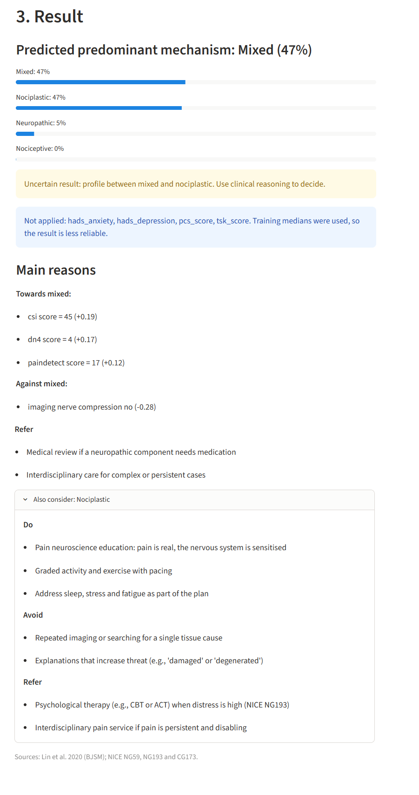

# Pain Mechanism Classifier

🇵🇹 [Versão em português](docs/README_pt.md)

**An educational decision-support prototype that suggests the predominant musculoskeletal pain mechanism (IASP) and shows guideline-based recommendations for health and movement professionals.**

> ⚠️ **Not a medical device. Trained on synthetic data. Not validated on real patients. Not for clinical use.**
> This is a portfolio project that demonstrates an end-to-end, responsible clinical machine learning workflow.

**🚀 Live demo:** [pain-mechanism-classifier.streamlit.app](https://pain-mechanism-classifier.streamlit.app)



---

## The problem

Musculoskeletal pain can be driven by different mechanisms: **nociceptive**, **neuropathic**, **nociplastic** (IASP descriptors) or a **mixed** presentation. Each one needs a different approach. Many professionals who see people with pain (physicians, physiotherapists, nurses, exercise physiologists, physical educators and personal trainers, manual therapists such as massage therapists) do not have a structured, evidence-based way to reason about the mechanism.

**This tool supports and educates. It does not diagnose.** It is meant for professionals, not for patients.

## How it works

```
1. Assessment form  →  2. Red-flag gate  →  3. ML model  →  4. Result
                            │                                 ├─ Probabilities + uncertainty warning
                            └─ Red flag? Refer.               ├─ Main reasons (explanation)
                               No classification.             └─ Guidelines: do / avoid / refer
```

1. **Red-flag gate (rules, not ML):** 7 red flags (Finucane et al., 2020), including serious imaging findings. If any is present, the app recommends medical referral and **stops**. The model never runs.
2. **Assessment form:** 13 inputs, including pain duration and distribution, DN4, painDETECT, CSI, sleep, imaging findings concordant with symptoms, and psychosocial factors (HADS, PCS, TSK, work stress). Questionnaires can be left empty when they were not applied.
3. **Model:** multinomial logistic regression that predicts the predominant mechanism.
4. **Result:**
   - probabilities for all four classes;
   - an **uncertainty warning** when the top two classes are within 15 percentage points;
   - warnings when no imaging is available or questionnaires are missing;
   - the main reasons for the prediction (linear contributions);
   - fixed **guideline-based recommendations** (Lin et al., 2020; NICE NG59, NG193, CG173).

## Data

- **Synthetic dataset of 2,000 patients**, generated in Python from published clinical criteria (IASP; Kosek et al., 2021; Finnerup et al., 2016; Smart et al., 2012). See [`docs/pain_mechanism_criteria.md`](docs/pain_mechanism_criteria.md).
- Realism by design:
  - probabilistic class patterns;
  - correlated variables;
  - informative missing data (MCAR, MAR, MNAR);
  - imaging "not performed" as an informative category;
  - an evidence-informed class balance (nociceptive 40%, mixed 25%, nociplastic 20%, neuropathic 15%).
- 190 patients with red flags (9.5%) were excluded before modelling. This left 1,810 patients, split 80/20 (stratified).

## Model and results

Logistic regression was chosen over a random forest with similar performance, because it is simpler and more interpretable.

| Held-out test set (n = 362) | Value |
|---|---|
| Balanced accuracy | 0.805 |
| Macro AUROC (one-vs-rest) | 0.96 |
| Accuracy | 0.826 |

| Mechanism | Precision | Recall (sensitivity) |
|---|---|---|
| Nociceptive | 0.95 | 0.99 |
| Neuropathic | 0.76 | 0.87 |
| Mixed | 0.69 | 0.62 |
| Nociplastic | 0.77 | 0.74 |

- Cross-validation (0.796) and test (0.805) results are close, so there is no sign of overfitting.
- Errors concentrate on the clinically ambiguous **mixed** class.
- The most harmful error (nociplastic predicted as nociceptive) occurred in 1 of 69 cases.

## Robustness and explainability

- **Prevalence shift** (chronic pain clinic case mix): balanced accuracy stayed stable (0.81). Precision changed with prevalence, as Bayes' theorem predicts.
- **No imaging available:** balanced accuracy 0.78; neuropathic sensitivity fell from 0.87 to 0.76. The app shows a warning in this case.
- **Explainability:** coefficients and SHAP values agree with the clinical criteria. Duration, widespread distribution and CSI drive nociplastic predictions; dermatomal distribution, painDETECT, DN4 and nerve compression drive neuropathic predictions. Psychosocial variables have near-zero weights.

## Responsible design

- **Safety first:** the red-flag gate comes before the model and should be repeated whenever new information appears.
- **No stigma:** psychosocial factors were generated in all classes, so the model does not learn that nociplastic pain is "psychological".
- **Honest uncertainty:** close probabilities are shown as "profile between X and Y", not as a single answer.
- **Clear roles:** professionals without diagnostic competence are told to use the output for education and referral only. The app does not recommend medication.
- **Documentation:** a [model card](docs/model_card.md) with an IMDRF-style intended-use statement, MINIMAR reporting, limitations, and steps needed before any real-world use.

## Limitations

- Synthetic data: the model learns the rules used to generate the data. The project shows the **method**, not clinical validity.
- Probabilities are not calibrated, and the 15-point uncertainty threshold is a design choice, not a validated value.
- Physical examination findings (e.g., neurodynamic tests, quantitative sensory testing, gait and functional movement assessment) are not modelled.
- No demographic variables, so subgroup fairness could not be assessed.
- No external validation.

## Repository structure

```
pain-mechanism-classifier/
├── app/
│   ├── app.py                       # Streamlit app
│   └── guidelines.py                # Fixed guideline content (not ML)
├── data/
│   └── synthetic_pain_patients.csv
├── docs/
│   ├── pain_mechanism_criteria.md   # Clinical criteria and references (+ PT version)
│   └── model_card.md                # Model card (+ PT version)
├── models/
│   └── pain_mechanism_model.joblib  # Trained pipeline
├── notebooks/
│   ├── 01_generate_synthetic_data.ipynb
│   ├── 02_exploratory_analysis.ipynb
│   └── 03_modeling.ipynb
└── requirements.txt
```

## How to run

```bash
git clone https://github.com/RenatoMurayama/pain-mechanism-classifier.git
cd pain-mechanism-classifier
python -m venv .venv
.venv\Scripts\activate          # Windows (macOS/Linux: source .venv/bin/activate)
pip install -r requirements.txt
streamlit run app/app.py
```

## Author

**Renato Murayama**: physiotherapist with 16 years of clinical experience and MSc Medical Informatics student at the University of Minho (Portugal).

This project consolidates what I learned in the **Stanford University AI in Healthcare Specialization** (Coursera): problem framing, clinical data, model evaluation, and responsible deployment.

[GitHub](https://github.com/RenatoMurayama)
