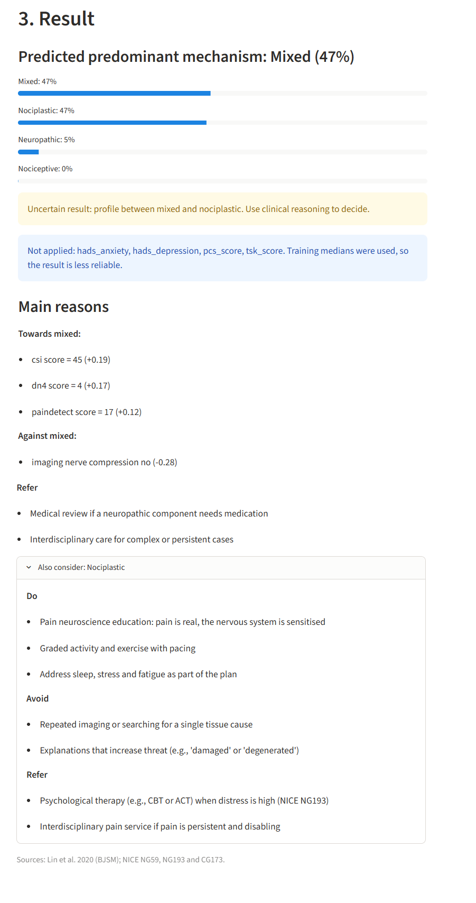

# Classificador de Mecanismos de Dor

🇬🇧 [English version](../README.md)

**Um protótipo educativo de apoio à decisão que sugere o mecanismo de dor musculoesquelética predominante (IASP) e mostra recomendações baseadas em diretrizes, para profissionais de saúde e do movimento.**

> ⚠️ **Não é um dispositivo médico. Treinado com dados sintéticos. Não foi validado em doentes reais. Não se destina a uso clínico.**
> Este é um projeto de portfólio que demonstra um fluxo completo e responsável de machine learning clínico.



---

## O problema

A dor musculoesquelética pode ter mecanismos diferentes: **nociceptivo**, **neuropático**, **nociplástico** (descritores IASP) ou um quadro **misto**. Cada um precisa de uma abordagem diferente. Muitos profissionais que acompanham pessoas com dor (médicos, fisioterapeutas, enfermeiros, fisiologistas do exercício, educadores físicos e personal trainers, terapeutas manuais como massoterapeutas) não têm uma forma estruturada e baseada em evidência de raciocinar sobre o mecanismo.

**Esta ferramenta apoia e educa. Não diagnostica.** Destina-se a profissionais, não a doentes.

## Como funciona

```
1. Formulário  →  2. Portão de red flags  →  3. Modelo de ML  →  4. Resultado
                       │                                           ├─ Probabilidades + aviso de incerteza
                       └─ Red flag? Encaminhar.                    ├─ Principais motivos (explicação)
                          Sem classificação.                       └─ Diretrizes: fazer / evitar / encaminhar
```

1. **Portão de red flags (regras, não ML):** 7 red flags (Finucane et al., 2020), incluindo achados graves de imagem. Se existir alguma, a app recomenda encaminhamento médico e **para**. O modelo nunca corre.
2. **Formulário:** 13 variáveis, incluindo duração e distribuição da dor, DN4, painDETECT, CSI, sono, achados de imagem concordantes com os sintomas e fatores psicossociais (HADS, PCS, TSK, stress laboral). Os questionários podem ficar vazios quando não foram aplicados.
3. **Modelo:** regressão logística multinomial que prevê o mecanismo predominante.
4. **Resultado:**
   - as probabilidades das quatro classes;
   - um **aviso de incerteza** quando as duas classes mais prováveis estão a menos de 15 pontos percentuais;
   - avisos quando não há imagem ou faltam questionários;
   - os principais motivos da previsão (contribuições lineares);
   - **recomendações fixas baseadas em diretrizes** (Lin et al., 2020; NICE NG59, NG193, CG173).

## Dados

- **Dataset sintético de 2000 doentes**, gerado em Python a partir de critérios clínicos publicados (IASP; Kosek et al., 2021; Finnerup et al., 2016; Smart et al., 2012). Ver [`pain_mechanism_criteria_pt.md`](pain_mechanism_criteria_pt.md).
- Realismo por desenho:
  - padrões probabilísticos por classe;
  - variáveis correlacionadas;
  - dados em falta informativos (MCAR, MAR, MNAR);
  - o "exame não realizado" como categoria informativa;
  - uma prevalência das classes baseada na evidência (nociceptiva 40%, mista 25%, nociplástica 20%, neuropática 15%).
- 190 doentes com red flags (9,5%) foram excluídos antes da modelação. Ficaram 1810 doentes, divididos 80/20 (estratificado).

## Modelo e resultados

Escolheu-se a regressão logística em vez de uma random forest com desempenho semelhante, por ser mais simples e interpretável.

| Conjunto de teste (n = 362) | Valor |
|---|---|
| Balanced accuracy | 0,805 |
| AUROC macro (um-contra-todos) | 0,96 |
| Accuracy | 0,826 |

| Mecanismo | Precisão | Recall (sensibilidade) |
|---|---|---|
| Nociceptiva | 0,95 | 0,99 |
| Neuropática | 0,76 | 0,87 |
| Mista | 0,69 | 0,62 |
| Nociplástica | 0,77 | 0,74 |

- Os resultados da validação cruzada (0,796) e do teste (0,805) são próximos, logo não há sinais de overfitting.
- Os erros concentram-se na classe **mista**, clinicamente ambígua.
- O erro mais prejudicial (nociplástica prevista como nociceptiva) aconteceu em 1 de 69 casos.

## Robustez e explicabilidade

- **Mudança de prevalência** (casuística de clínica de dor crónica): a balanced accuracy manteve-se estável (0,81). A precisão mudou com a prevalência, como prevê o teorema de Bayes.
- **Sem imagem disponível:** balanced accuracy 0,78; a sensibilidade da neuropática desceu de 0,87 para 0,76. A app mostra um aviso nesse caso.
- **Explicabilidade:** os coeficientes e os valores SHAP concordam com os critérios clínicos. A duração, a distribuição difusa e o CSI levam a previsões nociplásticas; a distribuição em dermátomo, o painDETECT, o DN4 e a compressão nervosa levam a previsões neuropáticas. As variáveis psicossociais têm pesos próximos de zero.

## Desenho responsável

- **Segurança primeiro:** o portão de red flags vem antes do modelo e deve ser repetido sempre que surgir informação nova.
- **Sem estigma:** os fatores psicossociais foram gerados em todas as classes, para o modelo não aprender que a dor nociplástica é "psicológica".
- **Incerteza honesta:** probabilidades próximas são mostradas como "perfil entre X e Y", e não como uma resposta única.
- **Papéis claros:** os profissionais sem competência diagnóstica são orientados a usar o resultado só para educação e encaminhamento. A app não recomenda medicação.
- **Documentação:** um [model card](model_card_pt.md) com uma definição de uso previsto ao estilo IMDRF, relato MINIMAR, limitações e os passos necessários antes de qualquer uso real.

## Limitações

- Dados sintéticos: o modelo aprende as regras usadas para gerar os dados. O projeto demonstra o **método**, não a validade clínica.
- As probabilidades não estão calibradas, e o limiar de incerteza de 15 pontos é uma escolha de desenho, não um valor validado.
- Os achados do exame físico (ex.: testes neurodinâmicos, testes sensitivos quantitativos, avaliação da marcha e dos movimentos funcionais) não foram modelados.
- Sem variáveis demográficas, por isso não foi possível avaliar a equidade por subgrupos.
- Sem validação externa.

## Estrutura do repositório

```
pain-mechanism-classifier/
├── app/
│   ├── app.py                       # App Streamlit
│   └── guidelines.py                # Conteúdo fixo das diretrizes (não é ML)
├── data/
│   └── synthetic_pain_patients.csv
├── docs/
│   ├── pain_mechanism_criteria.md   # Critérios clínicos e referências (+ versão PT)
│   └── model_card.md                # Model card (+ versão PT)
├── models/
│   └── pain_mechanism_model.joblib  # Pipeline treinado
├── notebooks/
│   ├── 01_generate_synthetic_data.ipynb
│   ├── 02_exploratory_analysis.ipynb
│   └── 03_modeling.ipynb
└── requirements.txt
```

## Como correr

```bash
git clone https://github.com/RenatoMurayama/pain-mechanism-classifier.git
cd pain-mechanism-classifier
python -m venv .venv
.venv\Scripts\activate          # Windows (macOS/Linux: source .venv/bin/activate)
pip install -r requirements.txt
streamlit run app/app.py
```

## Autor

**Renato Murayama**: fisioterapeuta com 16 anos de experiência clínica e mestrando em Informática Médica na Universidade do Minho (Portugal).

Este projeto consolida o que aprendi na **especialização AI in Healthcare da Stanford University** (Coursera): enquadramento do problema, dados clínicos, avaliação de modelos e implementação responsável.

[GitHub](https://github.com/RenatoMurayama)
